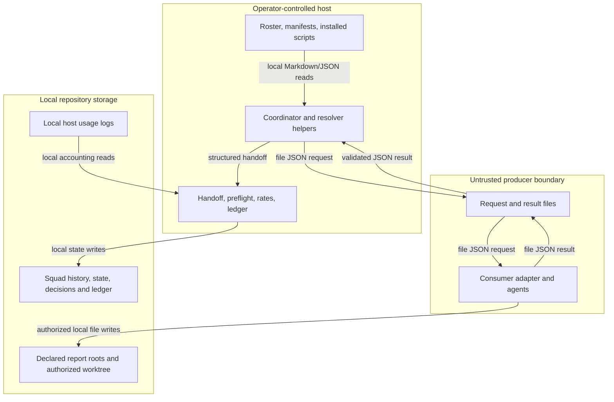

<!-- markdownlint-disable-file -->
# Squad Skill Security Model

The runtime comprises `Resolve-SquadConnectorDispatch.ps1`,
`Invoke-SquadConnectorDispatch.ps1`,
`Resolve-SquadConnectorHistory.ps1`,
`Resolve-SquadModelRoute.ps1`, `Get-SquadDispatchBrief.ps1`,
`Write-SquadHandoff.ps1`, `Measure-SquadLedger.ps1`,
`Set-SquadCostPreflight.ps1`, and `Initialize-SquadConsumptionRates.ps1`.
The two buckets below cover configuration/dispatch and file exchange/persistence.
Each enumerates all six STRIDE categories. Agent instructions are procedural
controls, not a sandbox or a substitute for host filesystem permissions.

> See also: [repo-wide STRIDE model registry](https://github.com/Peter-N91/hve-squad/blob/main/docs/security/security-model.md#skill-security-models).
> This repository previously had a security policy but no model registry; that
> registry indexes this scoped model, not a completed repository-wide assessment.

## Executive Summary

### Security Posture Overview

| Surface | Current controls | Residual boundary |
|---|---|---|
| Routing and registration | Explicit roster bindings, manifest role admission, reserved governance roles, fail-closed ambiguity | Configuration and installed scripts must remain operator-controlled. |
| External file exchange | Closed schemas, request/result identity matching, output allowlists, structural path containment | A matching envelope does not authenticate its author. |
| Persistence | Scribe payload validation, binding-matched provenance, distinct member accounting, ledger checks | History is local and editable by principals with repository write access. |
| Domain execution | Consumer-owned adapter; no connector command execution | Host permissions and consumer automation govern actual source changes. |

Ratings are qualitative under the assumption that an external producer can
write its mailbox, but cannot modify trusted configuration or shipped scripts.
Different filesystem permissions or unattended policies change the risk.

## Contents

* [System Description](#system-description)
* [Trust Boundaries](#trust-boundaries)
* [Assets](#assets)
* [Adversaries](#adversaries)
* [Bucket B1: Configuration and Dispatch](#bucket-b1-configuration-and-dispatch)
* [Bucket B2: File Exchange and Persistence](#bucket-b2-file-exchange-and-persistence)
* [Enterprise Readiness Gaps](#enterprise-readiness-gaps)
* [References](#references)

## System Description

### Components

* The coordinator classifies work and retains governance and admission.
* Connector/model resolvers and the dispatch brief read roster, manifests,
  packaged model metadata, and local availability information.
* The thin connector agent runs the lifecycle wrapper once. That wrapper owns
  request/snapshot publication, result checks, and private replay state; the
  shared resolver remains side-effect free.
* The historical identity helper validates confirmed retirement snapshots for
  the ledger and assurance reader. Exact completed headings scope that evidence;
  it cannot register a removed endpoint or authorize later work.
* The consumer's adapter runs its own agents or workflow outside this package.
* The handoff writer, ledger calculator, preflight helper, and rate seeder write
  their declared local state/output files. The ledger can read local host usage
  logs for accounting; those logs are not connector identity evidence.

### Data Flow



## Trust Boundaries

### Boundary Diagram

```text
+---------------------------+       +---------------------------+
| Trusted host/configuration |       | Consumer process          |
| Coordinator and helpers    |--JSON-| Own agents and skills     |
| Scribe and preflight       |<-files| No HVE governance authority|
+-------------+-------------+       +-------------+-------------+
              | authorized writes                  | scoped writes
+-------------v-----------------------------------v-------------+
| Local files: reports/worktree, history, state, usage accounting |
| Permissions, process isolation and backup are host concerns.   |
+---------------------------------------------------------------+
```

### Boundary Descriptions

| Boundary | Trusted input | Untrusted or separately controlled input |
|---|---|---|
| B1 configuration to dispatch | Operator-confirmed roster and installed helpers | User task prose and external narrative cannot grant role authority. |
| B2 mailbox to validation | Pending request identity and declared output roots | Result JSON, artifact contents, endpoint availability, and fan-out claims |
| B2 persistence | Validated handoff and binding-derived identity | External outcome claims and host-log contents require their own validation. |

## Assets

| ID | Asset | Required property |
|---|---|---|
| A1 | Governance, council, and Scribe ownership | External work cannot acquire these authorities. |
| A2 | Declared reports and authorized source worktree | No undeclared overwrite or cross-squad write |
| A3 | Task/binding/member identity | Results stay attached to the intended request and squad. |
| A4 | History and accounting | External work stays unverified and unmetered; shim spend remains attributable. |
| A5 | Local inputs and host usage records | No unintended credential or raw-log disclosure |

## Adversaries

| ID | Capability | Assumption |
|---|---|---|
| ADV-a | Faulty or compromised external producer | Can send malformed/misleading results and modify files it is allowed to write |
| ADV-b | Another local process with mailbox access | Can race or replace an envelope; identity fields are not signatures. |
| ADV-c | Untrusted text in domain artifacts | Can make authority claims, but is data rather than an instruction source. |

## Bucket B1: Configuration and Dispatch

### Spoofing

The resolver binds connector id, endpoint kind, role, and target to a readable
manifest and applicable roster binding. These checks establish configuration
consistency, not the identity of the process behind a mailbox.

### Tampering

Closed fields and reserved role targets reject unsupported authority changes.
Keep roster/manifests and installed helpers writable only by trusted operators;
an adversary allowed to modify them can change the routing policy itself.

### Repudiation

Binding/member ids and Scribe-rendered provenance identify the selected
configuration. They are not a signed record of who authored that configuration.
Pending identity hashes include the external member and owning roster, so a
rename or cross-squad resume cannot silently relabel a result. Retirement records
retain historical attribution only while the trusted local record remains intact.

### Information Disclosure

Dispatch metadata and bounded inputs reach the selected endpoint. Limit those
inputs and output roots to the approved task. Required skill names are local
consumer configuration; manifests intentionally contain no credentials.

### Denial of Service

Unknown bindings and ambiguous execution stop or request clarification.
Unattended ambiguity fails closed. Invalid configuration can therefore block
work deliberately; it must not cause an inline substitute.

### Elevation of Privilege

Connector role targets cannot replace Scribe/council identities. Council routing
bypasses overlays; coordinator and Scribe targets are rejected in bindings,
envelopes, and persistence. Saved work-role defaults also apply in autopilot.
These routing controls
do not restrict the operating-system privileges of the consumer's runner.

### Risk Rating

| Threat | Likelihood | Impact | Residual Risk | Status |
|---|---|---|---|---|
| Untrusted prose changes role authority | Medium | High | Low | Closed binding checks and canonical council routing; host configuration remains trusted. |
| Configuration changed by a local writer | Deployment-dependent | High | Medium | Host ACLs and change review required; not authenticated by the skill. |

## Bucket B2: File Exchange and Persistence

### Spoofing

Task, connector, role, binding, and output ids must match the request. Single-agent
results may omit `outputs`; orchestrators use declared slots. A local mailbox
writer can still reproduce these ids. Scribe marks accepted work unverified.

### Tampering

The deterministic helper rejects undeclared output ids, escaping/reserved paths,
reparse points, file-type/size/depth/count violations, and secret-shaped content.
The wrapper supplies the real workspace and immutable collision baseline,
checks hashes, and publishes without overwrite. A stateless validation call
alone does not prove replay protection or request/snapshot immutability.
Use distinct write scopes; separate report roots do not isolate source writers.

### Repudiation

Scribe records bound member identities, timestamps, artifact references, and
trusted accounting markers, and checks the resulting ledger. Local history is
not an immutable audit store. The wrapper persists hashes, unanswered attempts,
and consumed ids under `dropPath/.squad-connector`, using an exclusive task lock
and atomic state updates before returning terminal results. The stateless
resolver cannot prevent replay alone. Protect private state from the producer:
a local principal able to rewrite or delete it can defeat those checks.
Confirmed binding changes retain prior identities through Scribe-owned retirement
decisions scoped to exact completed history entries. These decisions do not grant
dispatch authority and, like the roster, rely on trusted local state writers.

### Information Disclosure

Artifacts and usage logs may contain sensitive material. Apply the transport's
secret-content checks before accepting reports, and protect local logs and
outputs with host permissions. The wrapper returns validated metadata and
stable reasons, never raw external narrative or artifact contents. External
spend is not measured by the shim.

### Denial of Service

Missing results return `awaiting` and eventually escalate under deadline/retry
rules. The wrapper enforces protocol caps and atomic request publication;
consumers must also publish results atomically. The validator does
not supervise or terminate an external workflow.

### Elevation of Privilege

External content remains data and cannot approve a gate or supply a council
verdict. The connector has no command-execution transport. A consumer process
can nevertheless modify any files its own host credentials permit; use
least-privilege worktrees and isolation outside the prompt layer.

### Risk Rating

| Threat | Likelihood | Impact | Residual Risk | Status |
|---|---|---|---|---|
| Forged or replaced mailbox result | Medium | Medium | Medium | Identity checks and unverified marking; no message authentication |
| Escaping/undeclared report path | Medium | High | Medium | Wrapper filesystem/content checks tested; filesystem races and host permissions remain deployment boundaries |
| Duplicate/partial or absent delivery | Medium | Medium | Medium | Consumer/shim lifecycle and atomic publication required |
| Sensitive report/log disclosure | Deployment-dependent | High | Medium | Data minimization, content checks, and host ACLs required |

## Enterprise Readiness Gaps

| ID | Severity | Gap | Status |
|---|---|---|---|
| G-SPF-1 | Spoofing-Med | File identities do not authenticate the producer. | Accepted transport limitation; require an appropriately protected mailbox. |
| G-TAM-1 | Tampering-Med | A stateless validation call alone does not establish lifecycle integrity. | Use the lifecycle wrapper and protect its private state with host permissions. |
| G-REP-1 | Repudiation-Med | Local durable replay state is not an immutable audit store. | Wrapper enforces consumption; host ACLs, retention, and backups remain consumer responsibilities. |
| G-INF-1 | InfoDisc-Med | Sensitive source/report/log access depends on host permissions and consumer data handling. | Consumer deployment responsibility |
| G-DOS-1 | DoS-Med | No packaged external runner, process supervision, or live transport | External runner and wake-up remain consumer-owned. |

## References

* [Connector transport contract](references/connector-contract.md)
* [Connector binding and governance contract](references/connector-role-modes.md)
* [Connector resolver](scripts/Resolve-SquadConnectorDispatch.ps1)
* [Connector lifecycle wrapper](scripts/Invoke-SquadConnectorDispatch.ps1)
* [Handoff writer](scripts/Write-SquadHandoff.ps1)
* [Consumer guide and examples](https://github.com/Peter-N91/hve-squad/blob/main/docs/templates/connector-example/CONSUMER-GUIDE.md)
* [Repository security policy](https://github.com/Peter-N91/hve-squad/blob/main/SECURITY.md)
